<div align="center">

# ◆ PRYSM

### Turn market noise into competitive signals.

**An evidence-first competitor intelligence & market monitoring platform.**
Every claim is dated. Every claim is sourced. Every claim is verifiable.

`HACKNOVA'26` · `Competitor Intelligence and Market Monitoring Agent`

[Live Demo](#) · [Demo Video](#) · [Slides](#) · [Quick Start](#-quick-start)

<!-- Replace with a real hero screenshot: docs/screenshots/dashboard.png -->
<!--  -->

</div>

---

## 📌 The Problem

Businesses need to know when a competitor changes pricing, ships a feature, announces a launch, or shifts positioning. Today that means analysts manually revisiting pages, eyeballing differences, pasting screenshots into slides, and **hoping nobody asks "where did you get that?"**

Three things break down:

1. **Noise.** Most webpage changes are irrelevant: banners, timestamps, layout tweaks, rotating testimonials.
2. **Memory.** Without a dated history, you can't say *when* something changed or how a competitor has moved over time.
3. **Trust.** Reports full of unsourced claims can't be defended in a strategy meeting.

## 💡 The PRYSM Approach

PRYSM treats competitive intelligence as an **evidence pipeline**, not a summarization problem.

```mermaid
flowchart LR
    A["🌐 Observe<br/>permitted public pages"] --> B["🧹 Normalize<br/>strip volatile noise"]
    B --> C["🧩 Extract<br/>structured fields"]
    C --> D["🔍 Diff<br/>vs last accepted snapshot"]
    D --> E["🏷️ Classify<br/>pricing / feature /<br/>announcement / positioning"]
    E --> F["📊 Score<br/>significance 0-100"]
    F --> G["🗄️ Record<br/>dated + SHA-256"]
    G --> H{"Above alert<br/>threshold?"}
    H -- Yes --> I["🔔 Alert"]
    H -- No --> J["📝 Digest only"]
    I --> K["📄 Report<br/>claim → [n] → source + date"]
    J --> K

    classDef stage fill:#12141A,stroke:#3B82F6,color:#E6E8EE;
    classDef decision fill:#1A1D26,stroke:#6366F1,color:#E6E8EE;
    classDef out fill:#0F1F17,stroke:#22C55E,color:#E6E8EE;
    class A,B,C,D,E,F,G stage;
    class H decision;
    class I,J,K out;
```

> **Design principle:** if PRYSM cannot point to a source and an observation date for a statement, the statement does not appear in a report.

---

## ✅ Requirements Coverage

Mapped directly to the HACKNOVA'26 problem statement.

| Expected Feature / Deliverable | PRYSM Implementation | Where |
|---|---|---|
| **Competitor Monitoring** of permitted public sources | Competitor registry, per-source monitoring config, simulated multi-stage scan | `/competitors`, **Run Scan** |
| **Change Detection** across pricing, features, announcements, positioning | Category-aware semantic diffing with before/after state | `/dashboard`, `/radar` |
| **Historical Tracking** with dated records | Snapshot history + chronological change stream | `/timeline`, competitor **History** tab |
| **Competitor Comparison** on configurable criteria | Multi-criteria heatmap with user-selectable strategic vectors | `/comparison` |
| **Evidence-Linked Reporting** | Numbered citations `[1]`, `[2]` open the exact evidence artifact | `/reports/[id]`, Evidence Drawer |
| **Change Prioritization** | Business-significance score (10–100) and severity tiers | Radar, signal cards |
| **Notifications & Alerts** | Prioritized notification feed with read-state | Top-bar notifications |
| **Automated Report Generation** | Executive brief: summary, key changes, movement matrix, implications, actions, appendix | `/reports` |
| **Interactive Dashboard** | Command Center with KPIs, threat gauge, activity chart, global search | `/dashboard`, `Cmd/Ctrl + K` |
| **Required demo**: monitor pages → simulated change → sourced report | One-click Acme Pro pricing (+30%) scenario, end to end | [Demo Flow](#-3-minute-demo-flow) |

---

## ✨ Features

### 🎯 Competitive Command Center `/dashboard`
- **4 KPI cards with sparklines** for a live read on market movement
- **Critical signal cards** with visual before/after diffs
- **Threat overview gauge** (0–100 composite score)
- **Market signal activity chart** with 7D / 30D / 90D windows
- **Featured Signal banner** to trigger the demo scenario in one click

### 🔎 Verified Evidence Drawer
Opens from anywhere in the app. Every signal and every report citation resolves here.
- Exact **before → after** state (e.g. ₹999 → ₹1,299 / month)
- **Observation timestamp** and **source URL**
- **Detection method** and **confidence score**
- **SHA-256 content digest** and raw DOM excerpt
- **"Why it matters"** strategic implication
- **Analyst notes** you can attach and persist

### 🏢 Competitor Profiles `/competitors/[id]`
Table or card view, with a 7-tab deep dive: **Overview · Pricing · Feature Matrix · Positioning · Announcements · History · Evidence**
- Pricing tiers with ₹ / $ and % change
- Feature matrix states: ✓ Available, — Not Available, `NEW`, `UPDATED`
- Positioning shift analysis

### 📡 Change Radar `/radar`
2D scatter of **recency × business impact**. Bubble size = significance, color = category. Instantly separates the three changes that matter from the thirty that don't.

### 🕰 Competitive Timeline `/timeline`
Chronological stream of market shifts with category and timeframe filters.

### 🧮 Comparison Matrix `/comparison`
Choose your own strategic vectors. PRYSM renders a multi-criteria heatmap and writes a **PRYSM Intelligence** narrative summarizing where each competitor leads or lags.

### 📄 Executive Intelligence Brief `/reports/[id]`
Executive Summary → Key Changes → Movement Matrix → Strategic Implications → Recommended Actions → Evidence Appendix. Citation markers `[1]`, `[2]`, `[5]` are clickable and open the underlying evidence.

### ⚙️ Run Scan (interactive simulation)
A 5-stage pipeline walkthrough: **DOM collection → content normalization → semantic diffing → threat scoring → SHA-256 evidence verification.**

### ⌨️ Global Search
`Cmd/Ctrl + K` searches competitors, signals, evidence, and reports.

---

## 🎬 3-Minute Demo Flow

| # | Action | What to notice |
|---|---|---|
| 1 | Open `/dashboard` | Featured Signal banner, KPI sparklines, threat gauge |
| 2 | Click **"1-Click Demo: Acme Pro Pricing (+30%)"** | Evidence Drawer slides in |
| 3 | Inspect the drawer | ₹999 → ₹1,299 diff, 97% confidence, SHA-256 digest, "Why it matters" |
| 4 | Add an analyst note, press `Esc` | Note persists on the evidence record |
| 5 | Click **Run Scan** → **Start Scan** | 5-stage pipeline completes with verified signals |
| 6 | Go to `/competitors` → **Acme Cloud** | Pricing, Feature Matrix, Positioning, History tabs |
| 7 | Go to `/radar` | Hover bubbles for impact outliers |
| 8 | Go to `/comparison` | Toggle criteria, read the synthesized narrative |
| 9 | Open `/reports/rep-weekly-20261023` | Click `[1]` → exact evidence opens in the drawer |

**The story in one sentence:** *a competitor raises its price, PRYSM catches it, scores it, records it with a hash and a date, alerts you, and drops a cited line into your weekly brief.*

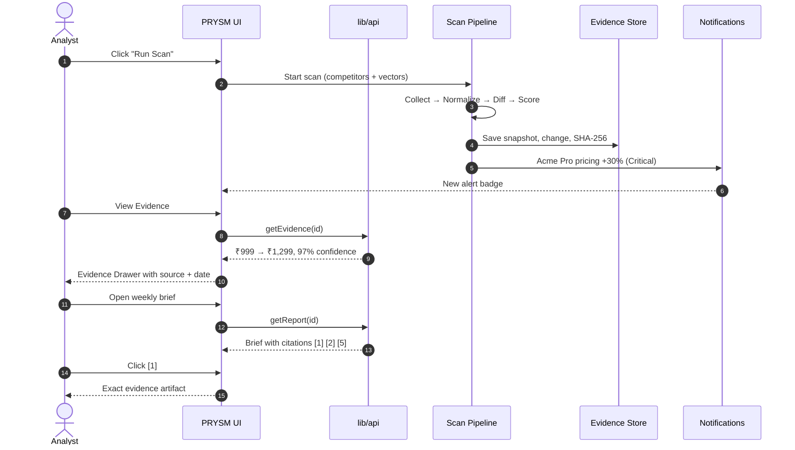

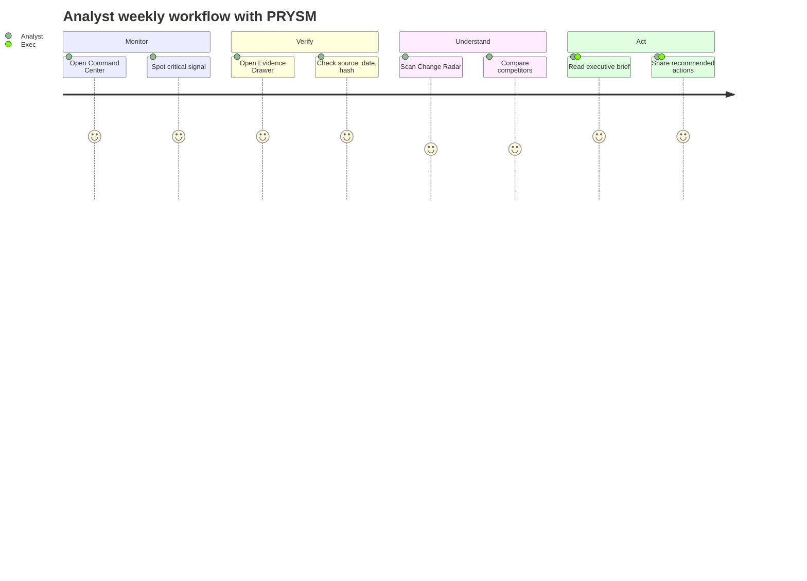

---

## 🧠 Change-Detection Methodology

The problem statement asks for **meaningful** changes, not *any* change. PRYSM's approach is a layered filter.

| Stage | Purpose | Examples |
|---|---|---|
| **1. Collect** | Fetch only permitted public pages | Pricing, features, blog/newsroom, homepage hero |
| **2. Normalize** | Strip volatile content before comparison | Scripts, ads, cookie banners, timestamps, session tokens, rotating widgets |
| **3. Extract** | Pull structured fields from the page | Price + currency + billing period, feature list, headline, CTA |
| **4. Diff** | Compare against the last accepted snapshot | Field-level before/after, not raw text diff |
| **5. Classify** | Assign a category | `pricing` · `feature` · `announcement` · `positioning` |
| **6. Score** | Rate business significance 0–100 | See below |
| **7. Record** | Store snapshot, diff, timestamp, digest | Dated and tamper-evident |
| **8. Route** | Alert only above threshold; batch the rest into reports | Minimizes alert fatigue |

### Significance scoring

Significance combines the signals an analyst would weigh intuitively:

```
significance = f( category weight,
                  magnitude of change,
                  competitor relevance,
                  recency,
                  detection confidence )
```

- **Category weight:** a price change outranks a copy tweak.
- **Magnitude:** +30% on a flagship tier outranks +2% on an add-on.
- **Relevance:** changes to a direct competitor's core product outrank peripheral ones.
- **Confidence:** low-confidence extractions are flagged, not silently trusted.

Alert tiers: **Critical → High → Medium → Low**. Only the upper tiers notify; everything is still recorded.

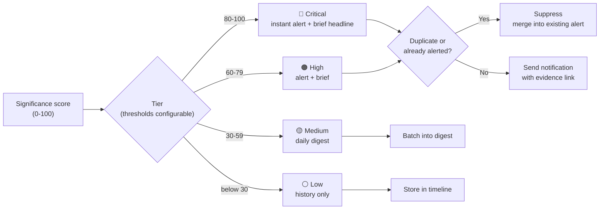

### Change lifecycle

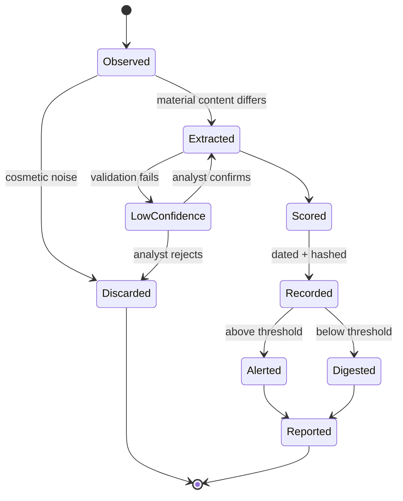

### Noise vs. signal: decision flow

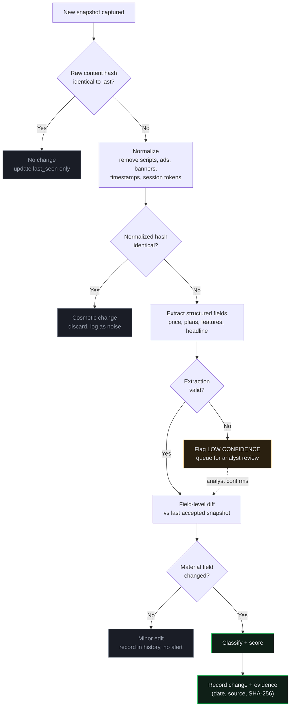

### Handling messy reality
Missing fields, restructured pages, and inconsistent formats are marked **low confidence** rather than guessed, and surfaced for analyst review.

---

## 🔐 Evidence Integrity

Every evidence record carries:

| Field | Purpose |
|---|---|
| `sourceUrl` | Where it was observed |
| `observedAt` | When it was observed |
| `beforeState` / `afterState` | The exact change |
| `detectionMethod` | How it was found |
| `confidence` | How sure PRYSM is |
| `sha256` | Digest of the captured content, so the record can be re-verified |
| `excerpt` | Raw captured content backing the claim |
| `notes` | Analyst annotations |

Reports cite these records by number. A reader goes from **sentence → citation → raw evidence** in one click.

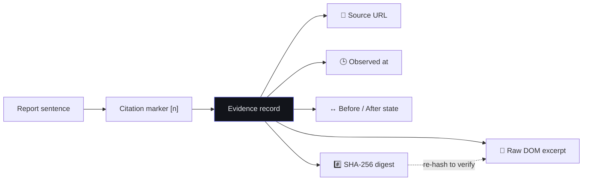

---

## ⚖️ Responsible Data Collection

The problem statement requires compliance with website terms and access restrictions. PRYSM is built around that:

- **Public pages only.** No logins, paywalls, or private data.
- **Respect `robots.txt`** and site terms; per-source allow-listing.
- **Polite crawling:** low frequency, rate-limited, identifiable user agent.
- **Prefer official sources:** public pricing pages, newsroom, changelogs, RSS, sitemaps, official APIs.
- **Archival sources** such as the Internet Archive Wayback Machine for historical baselines.
- **Provenance is always recorded**, so every datum is auditable.

---

## 🗂 Data Sources

| Source | Role |
|---|---|
| Public competitor pages (pricing, features, newsroom, changelog) | Primary monitoring targets |
| [Internet Archive Wayback Machine](https://web.archive.org/) | Historical snapshots to seed baselines |
| [Common Crawl](https://commoncrawl.org/) | Large-scale public crawl data for research |
| [Kaggle Datasets](https://www.kaggle.com/datasets) | Product and pricing datasets for prototyping (license permitting) |
| Curated sample data | Reproducible, controllable change scenarios for the demo |

> **Prototype note:** to keep the demo deterministic and judge-friendly, this build runs on curated sample data with a simulated scan. The data layer is deliberately isolated so a live collector plugs in without touching the UI (see [Architecture](#-architecture)).

---

## 🏗 Architecture

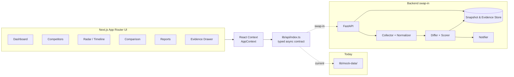

**Key decision:** the UI never touches mock data directly. It calls typed async functions that already match a REST shape, so moving to a real backend is a change inside `lib/api/`, not across components.

### Product map

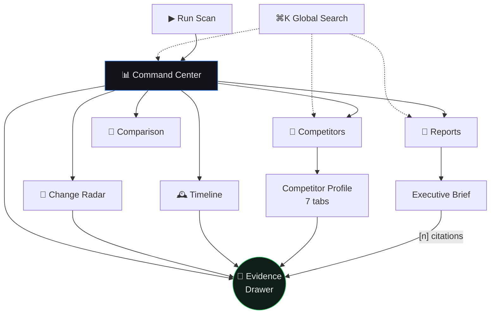

### Data model

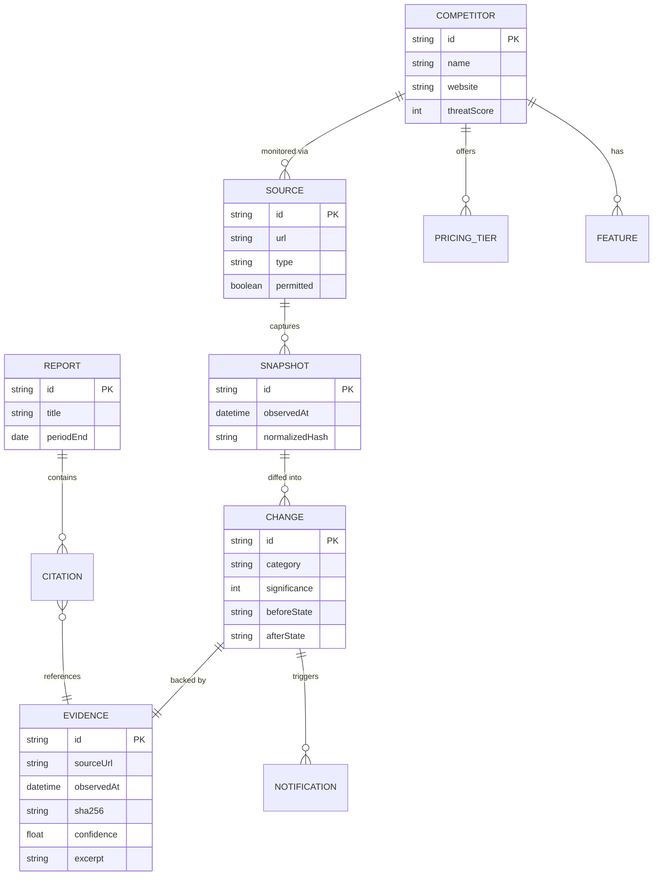

### API contract (`lib/api/index.ts`)

| Function | Future REST endpoint |
|---|---|
| `getCompetitors()` / `getCompetitor(id)` | `GET /api/competitors[/:id]` |
| `addCompetitor(data)` | `POST /api/competitors` |
| `getChanges(filters?)` / `getChange(id)` | `GET /api/changes[/:id]` |
| `getEvidenceList(competitorId?)` / `getEvidence(id)` | `GET /api/evidence[/:id]` |
| `addEvidenceNote(id, note)` | `POST /api/evidence/:id/notes` |
| `getReports()` / `getReport(id)` | `GET /api/reports[/:id]` |
| `getThreatOverview()` | `GET /api/threat-overview` |
| `getNotifications()` / `markAllNotificationsRead()` | `GET /api/notifications`, `POST /api/notifications/read` |
| *(scan trigger)* | `POST /api/scan` |

---

## 🛠 Tech Stack

| Layer | Choice |
|---|---|
| Framework | Next.js (App Router, Turbopack) |
| Language | TypeScript |
| Styling | Tailwind CSS with enterprise dark tokens |
| Charts | Recharts (area, scatter, radial, sparklines) |
| Icons | Lucide React |
| State | React Context |
| Backend (planned) | FastAPI, PostgreSQL, scheduled collectors |

### Design system
Inspired by **Linear × Vercel × Palantir**: dense, calm, and serious.
Background `#08090C` · borders `#262A33` · electric blue / indigo accents · restrained semantic colors reserved for real alerts.

---

## 🚀 Quick Start

**Requirements:** Node.js 18+

```bash
# 1. Clone
git clone https://github.com/PranavTechie23/<repo-name>.git
cd <repo-name>

# 2. Install
npm install

# 3. Run
npm run dev
# → http://localhost:3000/dashboard

# Production build
npm run build
```

---

## 📁 Project Structure

```
├── app/
│   ├── dashboard/            # Command Center
│   ├── competitors/          # Directory + [id] profiles
│   ├── radar/                # Change Radar
│   ├── timeline/             # Competitive Timeline
│   ├── comparison/           # Comparison Matrix
│   └── reports/              # Reports + [id] briefs
├── components/               # UI, Evidence Drawer, Scan modal, charts
├── context/AppContext.tsx    # Global state
└── lib/
    ├── api/index.ts          # Typed async API layer
    └── mock-data/            # Sample competitors, changes, evidence, reports
```

---

## 🎯 Evaluation Criteria Mapping

| Criterion | How PRYSM addresses it |
|---|---|
| **Accuracy of data collection & monitoring** | Source-scoped, permission-aware monitoring with provenance on every record |
| **Effectiveness of change detection** | Normalize → extract → field-level diff → classify → score, so noise is filtered before it counts |
| **Reliability of historical tracking** | Dated snapshots and changes, content hashed for re-verification |
| **Quality of competitor comparisons** | User-configurable criteria, heatmap plus generated narrative |
| **Accuracy of evidence & source links** | Citation `[n]` → evidence record → source URL, date, hash, excerpt |
| **Usefulness of alerts & reports** | Significance-gated alerts; briefs end in recommended actions |
| **Functionality & usability** | One-click demo, global search, evidence drawer reachable from every screen |

---

## ⚠️ Current Scope & Limitations

Being upfront about what this prototype is:

- Runs on **curated sample data**; the scan is an interactive **simulation** of the pipeline stages.
- Collector, differ, and scorer are **specified and API-ready**, not yet connected to a live backend.
- Report narratives are generated from structured evidence records in the demo dataset.

## 🗺 Roadmap

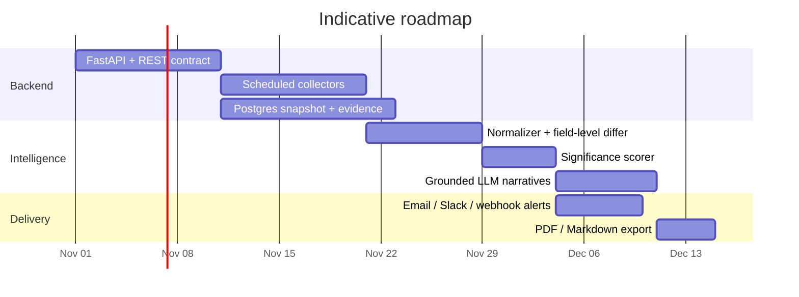

- [ ] FastAPI backend with scheduled collectors per source
- [ ] Persistent snapshot and evidence store (PostgreSQL)
- [ ] Live Wayback Machine baseline import
- [ ] LLM-assisted classification and narrative generation grounded strictly in stored evidence
- [ ] Email / Slack / webhook notifications with per-user thresholds
- [ ] Exportable reports (PDF / Markdown)
- [ ] Multi-workspace and role-based access

---

## 👥 Team

| Name | Role | GitHub |
|---|---|---|
| Pranav | Full-stack, product design | [@PranavTechie23](https://github.com/PranavTechie23) |
| _Add teammates_ | | |

---

<div align="center">

**PRYSM** · Observe. Verify. Decide.

*Built for HACKNOVA'26*

</div>k